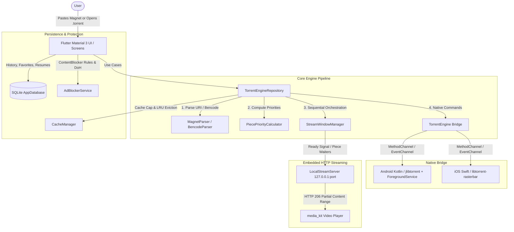

# StreamMagnet 🧲🎬

> **Production-Quality Cross-Platform Sequential Torrent Streaming App for Android & iOS**

StreamMagnet allows users to paste a magnet link or open a `.torrent` file and start playing high-definition video within seconds by downloading only the pieces needed at the playhead, sequentially, while buffering ahead.

The app ships with **NO** content, search, indexers, or links. Users supply their own legal magnet links.

---

## 🏗️ Architecture

StreamMagnet follows Feature-First Clean Architecture:

```
lib/
├── core/
│   ├── constants/       # AppConstants (timeouts, buffers, ports, priority windows)
│   ├── errors/          # Sealed AppFailure hierarchy
│   ├── logging/         # Centralized AppLogger
│   ├── theme/           # Material 3 Dark/Light Themes
│   └── utils/           # MagnetParser (hex/base32) & BencodeParser (.torrent)
├── data/
│   ├── adblock/         # ContentBlockerRules & AdBlockerService & DohService
│   ├── cache/           # CacheManager (LRU eviction behind playhead, auto-cleanup)
│   ├── database/        # SQLite AppDatabase (History, Favorites, Resumes)
│   ├── engine/          # TorrentEngine interface, PlatformTorrentEngine, SimulatedTorrentEngine
│   ├── http_server/     # LocalStreamServer (127.0.0.1, HTTP 206 Partial Content Range)
│   ├── repositories/    # TorrentEngineRepositoryImpl, SettingsRepositoryImpl
│   └── sequential/      # PiecePriorityCalculator & StreamWindowManager
├── domain/
│   ├── entities/        # TorrentInfo, StreamState, StreamTelemetry, PiecePriority, AppSettings
│   ├── repositories/    # TorrentEngineRepository, SettingsRepository
│   └── usecases/        # ResolveTorrent, StartStreaming, SeekStream, StopStreaming
├── features/
│   ├── browser/         # In-App WebView with ad/tracker blocking & magnet sniffer
│   ├── favorites/       # Saved magnet bookmarks with custom titles
│   ├── history/         # Searchable stream history with resume badges
│   ├── home/            # Paste input, clipboard detector, .torrent picker, details sheet
│   ├── onboarding/      # 3-screen concept & legal responsibility notice
│   ├── player/          # media_kit video player, gestures, telemetry overlay
│   ├── providers.dart   # Riverpod dependency injection graph
│   └── settings/        # Streaming limits, player settings, adblocker, cache clear
├── app.dart             # GoRouter navigation & MaterialApp
└── main.dart            # Entrypoint with media_kit and biometrics initialization
```

### High-Level Architecture Diagram



---

## ⚡ Key Features

1. **Sequential Streaming Engine**:
   - **Container Header Prioritization**: Automatically prioritizes the first 4 and last 4 pieces of the file (MP4 `ftyp`/`moov` atoms and MKV `EBML`/cues).
   - **Playhead Sliding Window**: Highest priority on pieces around the playhead (12 MB urgent window), medium priority on look-ahead buffer (64 MB), lowest priority on remainder.
   - **Seek Responsiveness**: On seek, immediately resets deadlines, re-prioritizes pieces around the new seek position, and buffers smoothly.
   - **Ready Threshold**: Starts video playback as soon as headers and the initial buffer (8 MB) arrive.

2. **Embedded HTTP Range Server**:
   - Serves local video at `http://127.0.0.1:<random-port>/stream/<session-id>?token=<token>`.
   - Full HTTP 206 Partial Content, Range header parsing, HEAD requests, and Content-Range calculations.
   - Blocks responses asynchronously until requested piece ranges are verified, preventing playback underrun errors.

3. **Built-in Content & Ad Blocker**:
   - Compiles native content blocker rules for `flutter_inappwebview` on Android and iOS.
   - Blocks ad networks, tracking scripts, forced redirects, and unrequested popup windows.
   - Per-site allowlist and live blocked counters.
   - Automatic Magnet Link Sniffer: detects magnet links on browsed web pages and displays a "Stream Found Magnet" action banner.

4. **Media Player**:
   - Powered by `media_kit` (libmpv) with hardware-accelerated video decoding.
   - Subtitle selection (.srt, .vtt, .ass) with font size customization.
   - Adaptive buffering: pauses and displays live download speed, seeds, and peer count if the buffer drops below safe limits.
   - Stats for Geeks overlay: real-time telemetry (speeds, seeds, peers, buffer ahead MB/s).

5. **Storage & LRU Cache**:
   - Configurable cache cap (default 2 GB, 512 MB - 16 GB).
   - LRU eviction of pieces behind the playhead.
   - Automatic session cache cleanup on stream completion or app restart.

---

## 🛠️ Build & Run Instructions

### Prerequisites
- Flutter SDK (stable channel, 3.22+ / 3.44+)
- Dart SDK 3.0+
- Android Studio / Xcode

### Running the App

```bash
# Get dependencies
flutter pub get

# Run on connected Android device / emulator
flutter run -d android

# Run on connected iOS device / simulator
flutter run -d ios
```

### Running Tests and Analyzer

```bash
# Run static analysis (0 warnings)
flutter analyze

# Run all unit and widget tests
flutter test
```

### Building Release Packages

#### Android (APK / App Bundle)
```bash
# Build release APK with ProGuard/R8 optimizations
flutter build apk --release

# Build release App Bundle
flutter build appbundle --release
```

#### iOS (IPA)
```bash
flutter build ipa --release
```

---

## ⚖️ Legal & Compliance
StreamMagnet is distributed as a neutral BitTorrent streaming utility. The software contains **NO** indexed content, search scrapers, or copyrighted works. Users must accept the Terms of Use and take sole responsibility for streaming only content they are legally authorized to access.
